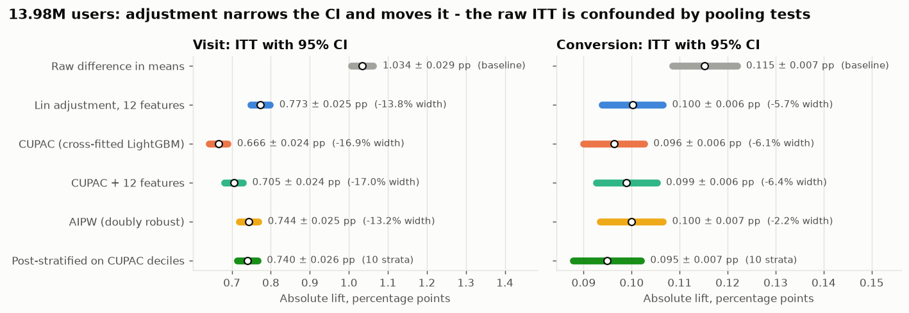
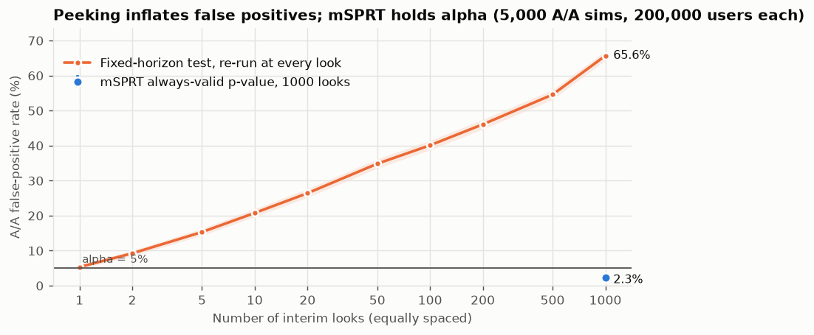
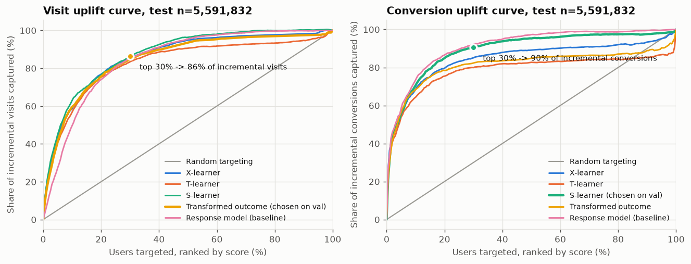

# uplift-lab

**An experimentation and causal-inference toolkit (`abkit`), validated against scipy / statsmodels /
scikit-uplift, applied end to end to Criteo's 13.98M-user advertising incrementality trial.**

## The problem

Criteo released a large randomized trial: 13,979,592 users, 85% shown display ads (treatment) and
15% held out (control), with visit and conversion outcomes and 12 anonymized pre-treatment
features. A product data scientist would be asked:

1. Is the experiment healthy (SRM, balance)?
2. What is the lift, with honest uncertainty, and how much can pre-treatment covariates tighten it
   (CUPED / CUPAC)?
3. Are the statistical tools calibrated: false-positive rate, peeking, power?
4. Who should be targeted? Is the effect heterogeneous enough for uplift modelling to beat
   targeting at random or by propensity?

**Main finding:** the SRM check passes, but the balance diagnostics do not. Treatment is weakly
predictable from the features (AUC 0.511, CI excludes 0.5), and the CSV is stored as 13 contiguous
single-arm blocks with visit rates of 0%-8.6%, i.e. several pooled tests. Every covariate-adjusted
and doubly-robust estimate of the visit lift is 25-36% below the raw difference in means (Hausman
z = 35-45), so the naive readout overstates the effect. Separately, cross-fitted CUPAC shrinks the
CI by 17%, the precision of a 31% larger experiment.

## Architecture

```
 Criteo CSV.gz (HF hub, sha256-checked)
        │  DuckDB (3 GB cap, 4 threads)
        ▼
 Parquet on D: ── row_id + stratified bucket (treatment × visit, 10 × 10%)
        │
        ├── readout ─────── SQL aggregates ── SRM · SMD · Welch · exact binomial bootstrap
        │                   2-fold cross-fitted LightGBM nuisances (outcome, per-arm, propensity)
        │                   one streamed pass ─► MomentAccumulator ─► Lin · CUPAC · AIPW · Hausman
        │
        ├── simulate ────── resample 2.1M real control users ─► A/A · peeking vs mSPRT · power
        │
        ├── uplift ──────── train(b0-3, 50%) / val(b4-5) / test(b6-9)
        │                   S · T · X · transformed-outcome learners vs response model & random
        │
        └── figures / report ─► reports/*.json ─► reports/readout.md + reports/figures/*.png

 src/abkit/  (the reusable, tested library; pipeline/ is the Criteo application)
   srm · balance · inference · power · variance_reduction · doubly_robust · sequential
   uplift/{learners, metrics} · analysis (one-call readout used by the Streamlit app)
```

## Results

Full population (13,979,592 users), CPU only, 4 threads, peak RAM 2.0 GB [`readout.json: peak_ram_gb`]. Sources in brackets.

| Question | Baseline | This repo |
|---|---|---|
| SRM vs 85/15 design | - | p = 0.999, no mismatch [`readout.json: srm`] |
| Treatment predictable from features? | 0.5 = random | AUC 0.511 (0.509-0.512) [`balance.treatment_predictability_auc`] |
| Visit ITT | Raw Welch 1.034 pp (1.006-1.063) | **AIPW 0.744 pp (0.719-0.768)**, +18.4% rel. [`adjusted.visit.aipw`] |
| Conversion ITT | Raw Welch 0.115 pp | AIPW 0.100 pp, +48.8% rel. [`adjusted.conversion.aipw`] |
| Visit CI width (variance reduction) | Raw ±0.0287 pp | CUPAC+Lin **−17.0%** = 31.1% sample-size saving [`adjusted.visit.cupac_plus_lin`] |
| Conversion CI width | Raw | CUPAC+Lin −6.4% = 12.5% sample-size saving |
| A/A false-positive rate, 10,000 sims | α = 5% | Welch 5.09%, CUPAC 4.91% (visit) [`simulations.json: aa`] |
| Peeking, 1,000 looks, 5,000 A/A sims | Fixed-horizon test: 65.6% FPR | mSPRT: **2.34%** FPR [`peeking`] |
| Power calculator vs simulation | - | max gap 1.1 pts (Welch), 0.5 pts (CUPAC) [`power`] |
{UPLIFT_ROWS}





The full narrative readout is in [`reports/readout.md`](reports/readout.md), generated from the JSON.

## Reproduce (≤ 3 commands)

```bash
uv sync --all-extras                 # Python 3.12 env (set UV_PROJECT_ENVIRONMENT to keep it off C:)
uv run uplift-lab all                # download + checksum, Parquet, readout, sims, uplift, figures, report (~1 h CPU)
uv run streamlit run app/streamlit_app.py   # sample-size / MDE calculator + CSV readout
```

Data goes to `$ML_DATA_ROOT/uplift` (default `D:/ml-portfolio/data/uplift`). `uv run pytest` runs the
fast CPU-only suite (no downloads). Individual stages: `uplift-lab prepare|readout|simulate|uplift|figures|report`.

## The `abkit` library

| Module | What | Validated against |
|---|---|---|
| `srm` | chi-square SRM check, minimum detectable share deviation | `scipy.stats.chisquare`, z² identity |
| `balance` | SMD, cross-validated treatment-predictability AUC | closed form, broken-randomization fixture |
| `inference` | Welch abs/relative lift (delta method), stratified + exact-binomial bootstrap | `scipy.stats.ttest_ind` (p, df, CI) |
| `power` | power, MDE, sample size, unequal allocation, variance-reduction input | `statsmodels NormalIndPower`, textbook formula |
| `variance_reduction` | CUPED, Lin interacted adjustment from streamed moments, cross-fitted CUPAC, leakage guard | statsmodels OLS (exact), HC2 SE (2%), 300-sim coverage |
| `doubly_robust` | cross-fitted AIPW, Hausman randomization check | pooled-tests fixture with known ATE |
| `sequential` | mSPRT always-valid p-values + confidence sequences | numerical integration, duality, A/A sim |
| `uplift` | S/T/X/transformed-outcome learners; Qini, uplift AUC, uplift@k, capture@k (weighted) | `scikit-uplift` 0.5.1 metrics (rel 1e-10) |

## Data and licenses

* **Data:** Criteo Uplift Prediction Dataset v2.1, `criteo-research-uplift-v2.1.csv.gz` from
  <https://huggingface.co/datasets/criteo/criteo-uplift> (official Criteo AI Lab upload), SHA-256
  `2716e1bf…f616dc`, 13,979,592 rows. **License: CC BY-NC-SA 4.0, non-commercial research use.**
  Not redistributed here. Cite Diemert et al., *A Large Scale Benchmark for Uplift Modeling*, AdKDD 2018.
* **Code:** MIT (see `LICENSE`). Dependencies are open source (DuckDB, LightGBM, scikit-learn,
  statsmodels, SciPy, Streamlit, scikit-uplift for test reference values).

## Limitations

* **Residual confounding.** Test ids are not released. Adjusted visit estimates range from 0.67 to
  0.77 pp, wider than their CIs, so the size of the raw overstatement depends on the model.
* **The CUPAC covariate is fit on in-experiment outcomes** (cross-fitted; there is no pre-period).
  That is valid, but it is not the textbook pre-period CUPED.
* **mSPRT is conservative** (A/A FPR 2.34%) and less powerful at a fixed horizon (55.9% vs 79.8%).
* **Uplift tuning is small:** two LightGBM configs per learner, training on a 50% sample of the
  train split.
* **CI is not yet run.** `.github/workflows/ci.yml` has never run on GitHub (local only, no
  remote). Ruff and pytest pass locally.
* The Streamlit app is tested headlessly with `streamlit.testing.AppTest`; it is not deployed.
